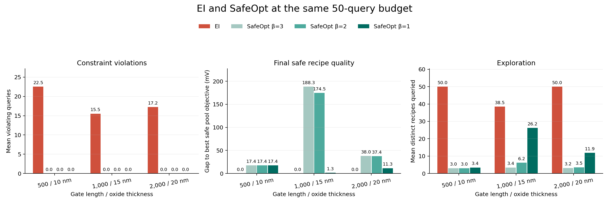
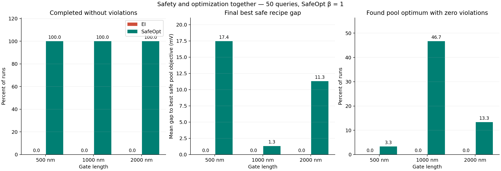
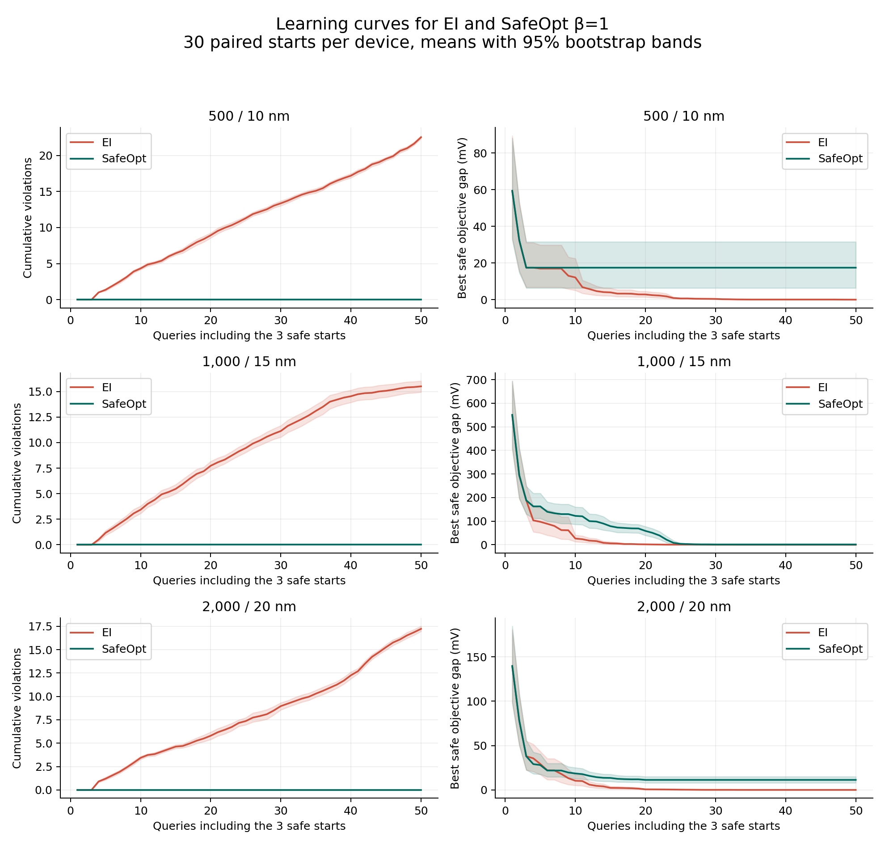
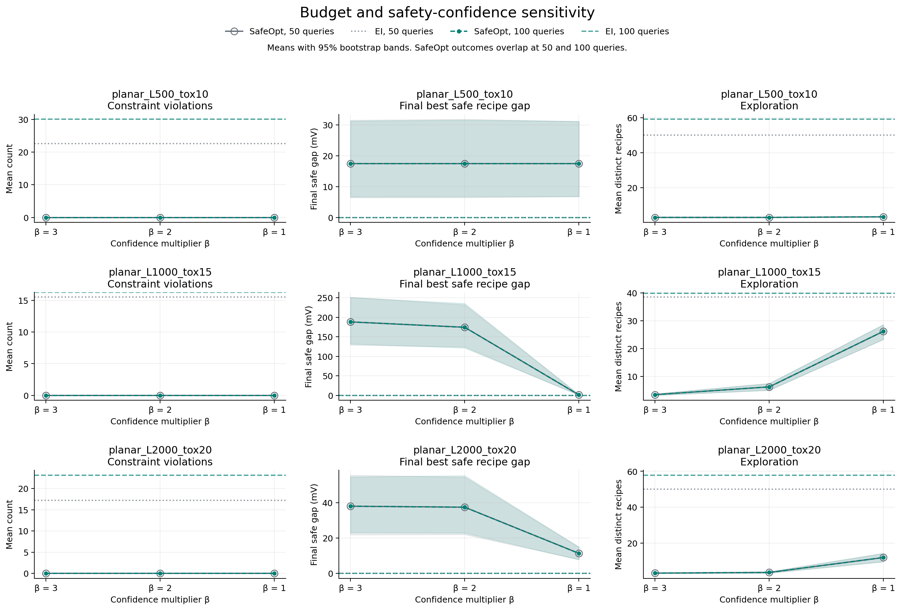

# Safety and performance of EI and SafeOpt

This numerical benchmark measures how safety during exploration affects the
quality of the recipe found within a query budget. The objective is nominal
threshold-voltage accuracy, with an off-state leakage constraint.

## Main comparison

Each device has 100 simulated candidate recipes. The methods share three safe
starting recipes in each of 30 paired runs. Every query, including a repeated
recipe, counts against the same budget. Unqueried outcomes stay hidden from
the optimizers. The table uses 50 queries and SafeOpt beta 1, the best confidence
setting explored in the sensitivity study.

| Gate length | EI mean violations | SafeOpt mean violations | EI final gap | SafeOpt final gap | Optimum with zero violations, EI / SafeOpt |
| --- | ---: | ---: | ---: | ---: | ---: |
| 500 nm | 22.53 | 0 | 0 mV | 17.45 mV | 0/30 / 1/30 |
| 1,000 nm | 15.50 | 0 | 0 mV | 1.32 mV | 0/30 / 14/30 |
| 2,000 nm | 17.23 | 0 | 0 mV | 11.29 mV | 0/30 / 4/30 |

Gap means the best safe pool objective minus the best safe objective found.
Lower is better. Joint successes include runs that started at the pool optimum.



EI reached the pool optimum in every run while also violating the constraint
in every run. SafeOpt avoided observed violations, with worse objective values
and less exploration. The observed safety advantage matters when the task
requires every evaluation to satisfy the constraint. For simulation-only work
that permits unsuccessful trials, these results favor EI on recipe quality.



## Learning during the search

The bands describe variation in the mean over random safe starting recipes on
these fixed pools. They are per-comparison bootstrap intervals. The cumulative
best-safe gap sums incumbent gaps, and the final gap compares the final recipe.



## Budget and confidence sensitivity

Beta multiplies GP uncertainty in the confidence bounds. The study tested beta
3, 2 and 1, with performance scored at 50 and 100 queries. Lowering beta helped
the 1,000 and 2,000 nm devices. SafeOpt's queries from 51 to 100 only repeated
previous recipes in every tested run, with no improvement in the final gap.
EI's longer runs produced additional violations after it had found the optimum.



## Scope and interpretation

This is a replay of reduced device simulations on fixed finite candidate pools.
Exceeding the leakage specification establishes modeled noncompliance. Physical
equipment damage and the financial consequences of a failure have not been
modeled. The replay consumes computer time and charges nominal query units.
It does not establish fabrication savings, simulation wall-time savings,
manufacturing yield, or a physical no-fail guarantee.

Both methods may repeat recipes. This equal-query accounting differs from
charging only unique, uncached TCAD evaluations. The exploration counts make
that distinction visible. At beta 1, SafeOpt tried a mean of 3.37, 26.20 and
11.87 distinct recipes on the 500, 1,000 and 2,000 nm pools. Its limited
exploration on the 500 nm case remains a weakness of this experiment.

The GP settings are fixed. Beta 1 was selected after inspecting the declared
grid, so its results are exploratory. Zero observed violations do not validate
the confidence bounds for physical use. The 1,000 nm pool combines pilot and
additional samples. Its unsafe fraction describes that finite pool.

## Tables and reproduction

- `comparison.csv` covers every device, budget, beta and method.
- `runs.csv` preserves each run's scores. Settings share starting recipes and
  budget prefixes, so these rows are matched observations.
- `paired_changes.csv` contains paired mean differences and bootstrap intervals.
- `settings.json` preserves the study, dataset hashes, code hashes and versions.
- The source data are committed under `../benchmark_data/`. Their original
  profile and IV paths are provenance fields. The replay uses the CSV values.

From the project root, regenerate the full study and compact report:

```powershell
python -m pip install -r bo_comparison/requirements.txt
python bo_comparison/run_sensitivity.py --input bo_comparison/benchmark_data --output bo_comparison/sensitivity --workers 3
python bo_comparison/plot_sensitivity.py --input bo_comparison/sensitivity
python bo_comparison/make_report.py --input bo_comparison/sensitivity
```

To open native Matplotlib comparison windows after generating the study:

```powershell
python bo_comparison/compare_methods.py --input bo_comparison/sensitivity --show
```

Detailed simulation caches and optimizer traces remain local and are ignored by
Git. The tracked dataset snapshots, tables and figures provide a compact record.
